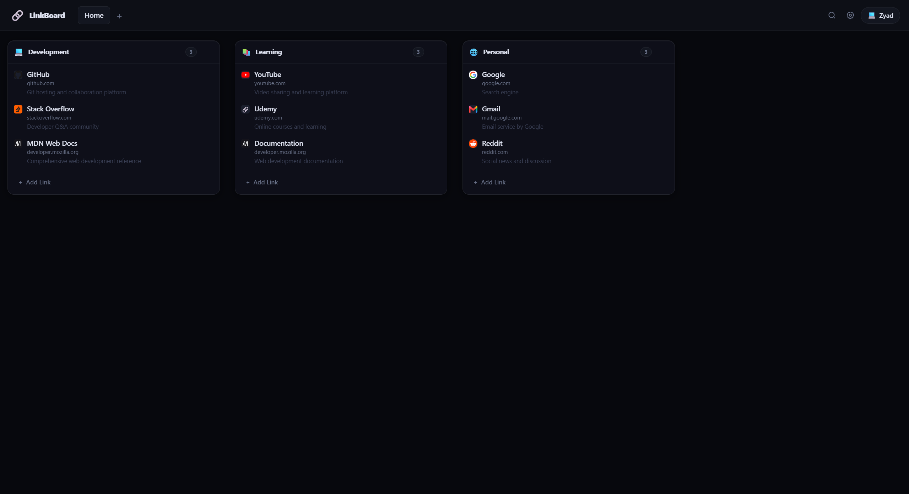
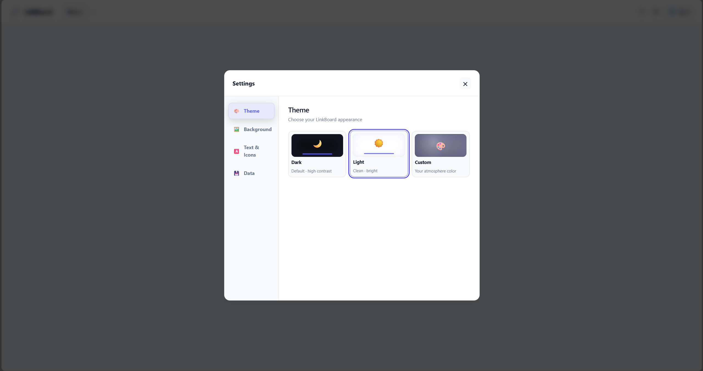

# 🔗 LinkBoard
> A lightweight and customizable browser New Tab extension for organizing your favorite websites into tabs, boards, and links.




---

## 🆕 What's New

### 🚀 Latest Updates

- 📦 **Data Import & Export:** Back up your workspace data and restore it whenever needed.
- 🎨 **Flexible Export Options:** Export workspace data only or include supported customization settings.
- 🔄 **Flexible Import Options:** Choose **Merge** to combine imported data with your existing workspace, or **Replace** to replace your existing workspace data.
- 🗂️ **Move Boards Between Tabs:** Move boards between tabs to organize your workspace more efficiently.


## 💡 Overview

**LinkBoard** is a lightweight and customizable browser **New Tab extension** that helps users organize their favorite websites in one convenient workspace.

Instead of keeping frequently visited websites scattered across bookmarks, browser tabs, or different folders, LinkBoard provides a visual system of **tabs, boards, and links** to keep everything organized and easy to access.

Users can create multiple tabs, organize related websites into boards, customize the appearance of their New Tab page, and quickly find saved websites using the built-in search.

LinkBoard is designed to provide a **simple, organized, personalized, and local-first browsing experience** without requiring an account or external backend.

## 🎯 Why This Extension?

LinkBoard was created to make managing frequently visited websites **simpler, more organized, and more personalized**.

Traditional browser bookmarks can become difficult to organize and quickly navigate. LinkBoard provides a visual workspace where users can group websites based on their needs and access them directly from the New Tab page.

### Key Goals

- 📌 Keep frequently used websites organized and easy to access
- 🗂️ Organize websites into tabs and boards
- 🖱️ Make rearranging links simple with drag and drop
- 🔍 Make saved websites easy to find with search
- 🎨 Give users control over the appearance of their New Tab page
- 💾 Keep user data stored locally without requiring an account
- ⚡ Provide a lightweight and responsive experience
- 🧩 Integrate directly with the browser's New Tab page

## 💾 Backup & Restore

LinkBoard allows you to export your workspace data and import it later to restore or reorganize your workspace.

### 📤 Export Options

- **Data Only:** Export your workspace data, including tabs, boards, and links, without customization settings.
- **Data with Customization Settings:** Export your workspace data along with supported appearance and customization settings.

### 📥 Import Options

- **Merge:** Combine imported workspace data with your existing data.
- **Replace:** Replace your existing workspace data with the imported data.

### 💡 Important Notes

- Back up your workspace before using Replace.
- Importing a data-only backup should preserve your existing customization settings.
- Background images are not included in exported backups and may need to be selected again after importing.


## 🖥️ Supported Browsers

LinkBoard is designed primarily for **Chromium-based browsers** that support Chrome Extension Manifest V3.

Currently supported browsers include:

- Google Chrome
- Microsoft Edge
- Brave
- Opera
- Other Chromium-based browsers that support Manifest V3

> **Firefox:** Firefox uses a different extension environment and may require additional Manifest/API adjustments. Firefox is not currently a fully supported target.

---

## 📥 Installation

LinkBoard is currently available as an **unpacked browser extension** through GitHub.

### Option 1 — Download from GitHub

1. Download the repository as a ZIP file.
2. Extract the ZIP file to a folder on your computer.
3. Open your browser's extensions page.
4. Enable **Developer mode**.
5. Click **Load unpacked**.
6. Select the extracted **LinkBoard** folder containing `manifest.json`.
7. Open a new tab to start using LinkBoard.

### Extensions Pages

| Browser | Extensions Page |
|---|---|
| Chrome | `chrome://extensions/` |
| Edge | `edge://extensions/` |
| Brave | `brave://extensions/` |
| Opera | `opera://extensions/` |

> The installation process is essentially the same across supported Chromium-based browsers. The main difference is the extensions page URL.

### Option 2 — Clone the Repository

Clone the repository using Git:

```bash
git clone https://github.com/zyad-ahmed-khalifa/linkboard-extension
```

Then:

1. Open your browser's extensions page.
2. Enable **Developer mode**.
3. Click **Load unpacked**.
4. Select the cloned **LinkBoard** folder containing `manifest.json`.
5. Open a new tab to start using LinkBoard.

## 🧪 Development

LinkBoard is built as a browser extension using standard web technologies and **Chrome Extension Manifest V3**.

### Technologies

- **HTML5**
- **CSS3**
- **Sass / SCSS**
- **Bootstrap 5.3**
- **Vanilla JavaScript ES6+**
- **Chrome Extension Manifest V3**
- **Chrome Extension APIs**
- **IndexedDB**
- **chrome.storage.local**

### Modify and Test

To work on the project:

1. Clone the repository or download the source code.
2. Make your changes to the HTML, CSS/SCSS, or JavaScript files.
3. Open your browser's extensions page.
4. Enable **Developer mode**.
5. Load the project using **Load unpacked**.
6. Select the LinkBoard folder containing `manifest.json`.
7. Open a new tab to test your changes.
8. After making additional changes, reload the extension from the browser's extensions page.

> LinkBoard does not require a build process or backend server to run as an extension.

---

## 📁 Project Structure

```text
LinkBoard-extension/
          ├── assets
          │   ├── icons
          │   │   ├── favicon.png
          │   │   ├── icon128.png
          │   │   ├── icon16.png
          │   │   ├── icon32.png
          │   │   └── icon48.png
          │   └── screenshots
          │       ├── preview2.png
          │       └── preview.png
          ├── css
          │   └── styles.css
          ├── js
          │   └── app.js
          ├── newtab.html
          ├── background.js
          ├── manifest.json
          ├── LICENSE
          └── README.md
```

> The project structure may change as LinkBoard continues to be developed.

## 🔐 Permissions & Privacy

LinkBoard follows a **local-first approach**, keeping user data stored locally in the browser and avoiding the need for an account or external backend.

### 🔒 Privacy

- No user account is required.
- No external backend or database is required.
- User-created tabs, boards, links, and settings are stored locally.
- LinkBoard does not intentionally collect or sell personal data.
- Custom background images are handled locally by the extension.
- Website favicon retrieval may require requests to external favicon services.

### 💾 Local Storage

LinkBoard uses browser storage mechanisms to preserve user data between sessions.

User data such as:

- Tabs
- Boards
- Links
- Settings
- Theme preferences
- Customization preferences

is stored locally in the user's browser.

### 🌐 External Favicon Requests

LinkBoard can automatically retrieve website favicons to display alongside saved links.

Favicon retrieval may require requests to external services. These requests are used to obtain website icons and are not intended to store or collect LinkBoard user data.

### 🔑 Manifest Permissions

LinkBoard requests only the browser permissions required for its functionality.

The exact permissions used by the extension are defined in:

```text
manifest.json
```

Users can review the requested permissions from their browser's extension management page.

> Permissions and external requests may vary depending on the current version of LinkBoard.

## 🔄 Updating the Extension

Since LinkBoard is currently installed manually as an unpacked extension, users can update it directly from the GitHub repository.

### Update Steps

1. Download the latest version of the repository or pull the latest changes using Git.
2. Replace the existing LinkBoard project files with the updated files.
3. Open your browser's extensions page.
4. Find **LinkBoard**.
5. Click **Reload**.
6. Open a new tab and verify that the updated version is working correctly.

> **Tip:** If you have important LinkBoard data stored locally, consider backing it up before making major changes or replacing the extension files.

---

## 🛠️ Issues & Bug Reports

Found a bug or something that isn't working as expected?

Please open a **GitHub Issue** and provide as much useful information as possible.

Include:

- A clear description of the problem
- Steps to reproduce the issue
- Your browser and browser version
- Screenshots or screen recordings when useful
- Relevant console errors, if available
- Any other information that may help reproduce the problem

Clear bug reports make it easier to investigate and fix issues.

---

## 💡 Feature Requests

Have an idea that could improve LinkBoard?

Open a **GitHub Issue** and describe:

- The feature you would like to see
- Why you think it would be useful
- How you expect it to work
- Any examples, references, or ideas that may help

Feature suggestions are welcome and can help shape future versions of LinkBoard.

---

## 🤝 Contributing

Contributions are welcome, especially:

- 🛠️ Bug fixes
- 🎨 UI improvements
- ♿ Accessibility improvements
- ⚡ Performance improvements
- 🌐 Browser compatibility improvements
- 📖 Documentation improvements
- 💡 Feature proposals and ideas

### Pull Requests

1. Fork the repository.
2. Create a new branch for your changes.
3. Make your changes.
4. Test the extension locally.
5. Commit your changes.
6. Push your branch to your fork.
7. Open a Pull Request.
8. Clearly describe your changes and why they are needed.

Please keep Pull Requests focused and avoid unrelated changes.

> **Important:** Contributing to LinkBoard does not grant permission to commercially use, sell, redistribute, sublicense, or relicense the project. Contributions remain subject to the project's license.

---

## 📜 License

LinkBoard is **source-available and not open source**.

The source code is publicly available so developers can **view, study, learn from, and use the project for personal or educational purposes**.

### Permitted Use

The license allows users to:

- View and study the source code
- Learn from the project
- Use the project for personal purposes
- Use the project for educational purposes
- Modify the project for personal or educational purposes
- Contribute improvements through Pull Requests

### Commercial Restrictions

**Commercial use is not permitted without explicit written permission from the copyright holder.**

Without explicit permission, you may not:

- Sell LinkBoard or modified versions of it
- Use LinkBoard in a commercial product or service
- Commercially redistribute the project
- Rebrand and commercially distribute modified versions
- Sublicense the project
- Claim the original project as your own

See the [`LICENSE`](LICENSE) file for the complete license terms.

> **Note:** Third-party libraries, assets, fonts, icons, and other dependencies included in or used by LinkBoard remain subject to their respective licenses.

## ⭐ Support

If you find LinkBoard useful or interesting, you can support the project by:

- ⭐ Starring the repository
- 👀 Exploring the source code
- 🛠️ Reporting bugs
- 💡 Suggesting features
- 🤝 Contributing through Pull Requests
- 🔗 Sharing the project with other developers
- 💻 Following me on GitHub and LinkedIn to see my future projects and updates

### 🌐 Follow Me

- 💻 GitHub: [zyad-ahmed-khalifa](https://github.com/zyad-ahmed-khalifa)
- 💼 LinkedIn: [Zyad Ahmed Khalifa](https://www.linkedin.com/in/zyad-ahmed-khalifa-92903b37b/)

Thanks for checking out **LinkBoard**! 🚀

**© 2026 Zyad Ahmed — LinkBoard. All rights reserved except as expressly permitted by the project license.**
